# Manual Técnico - C++ DISK ONLINE

**Universidad de San Carlos de Guatemala**  
**Facultad de Ingeniería**  
**Escuela de Ciencias y Sistemas**  
**Manejo e Implementación de Archivos**  
**Segundo Semestre 2026**

---

**Estudiante:** Cesar Armando García Franco  
**Carnet:** 202110378  
**Proyecto:** C++ DISK ONLINE (Proyecto 2)  
**Fecha:** Octubre 2026

---

## Índice

1. [Introducción](#1-introducción)
2. [Arquitectura del Sistema](#2-arquitectura-del-sistema)
3. [Despliegue en AWS](#3-despliegue-en-aws)
4. [Estructuras de Datos EXT3](#4-estructuras-de-datos-ext3)
5. [Comandos Implementados](#5-comandos-implementados)
6. [Sistema de Journaling](#6-sistema-de-journaling)
7. [Comandos Nuevos](#7-comandos-nuevos)
8. [Interfaz Gráfica](#8-interfaz-gráfica)
9. [Conclusiones](#9-conclusiones)

---

## 1. Introducción

**C++ DISK ONLINE** es la evolución del sistema de archivos simulado del Proyecto 1. Incorpora:

- **Despliegue en la nube** (AWS EC2 para backend, S3 para frontend)
- **Sistema de archivos EXT3** con journaling
- **Interfaz gráfica** para visualizar el sistema de archivos
- **Nuevos comandos** (add/delete, unmount, remove, rename, copy, move, find, chown)

### 1.1 Objetivos

- Implementar un sistema de archivos EXT3 con journaling
- Desplegar backend en EC2 y frontend en S3
- Desarrollar una GUI para visualizar discos, particiones, carpetas y archivos
- Implementar comandos avanzados de manipulación de archivos

### 1.2 Tecnologías Utilizadas

| Componente | Tecnología |
|------------|-----------|
| Backend | C++ 17 |
| Servidor HTTP | cpp-httplib |
| JSON | nlohmann/json |
| Reportes | Graphviz |
| Frontend | React + Vite |
| Nube Backend | AWS EC2 (Ubuntu 24.04) |
| Nube Frontend | AWS S3 (Static Website) |
| Sistema Operativo | Linux |

---

## 2. Arquitectura del Sistema

### 2.1 Visión General

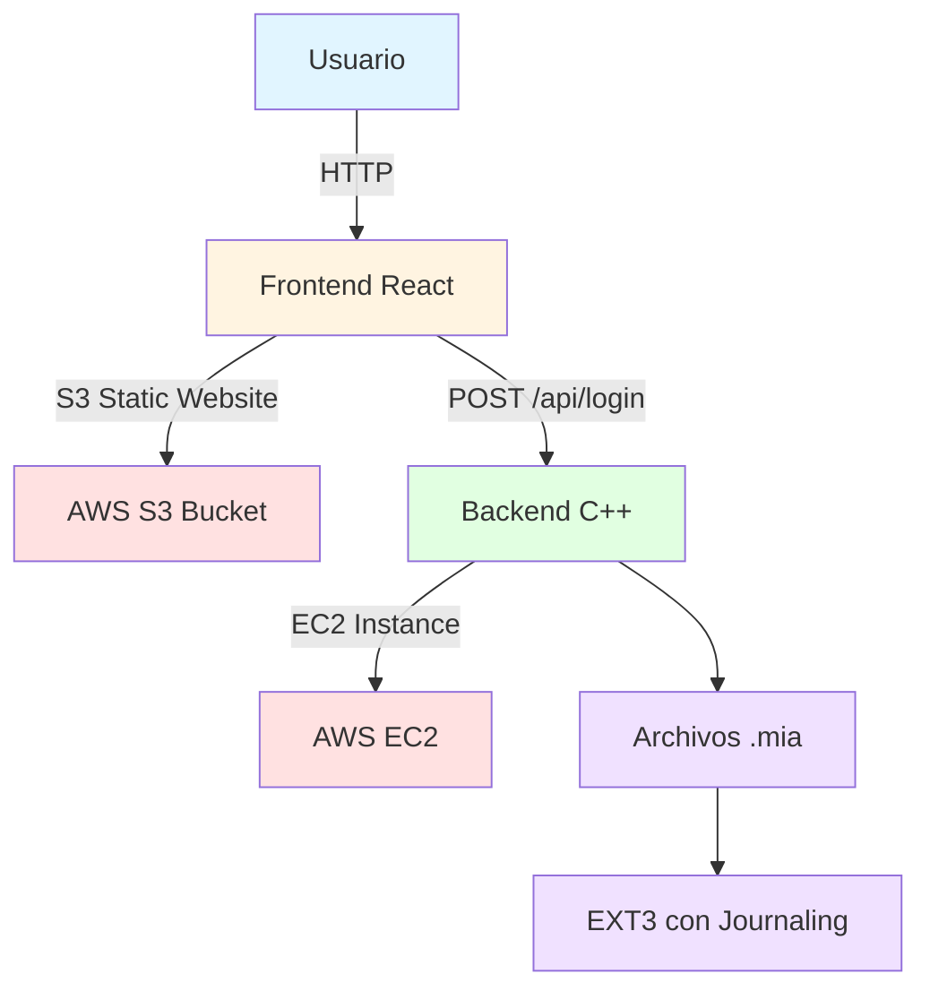

### 2.2 Flujo de Datos

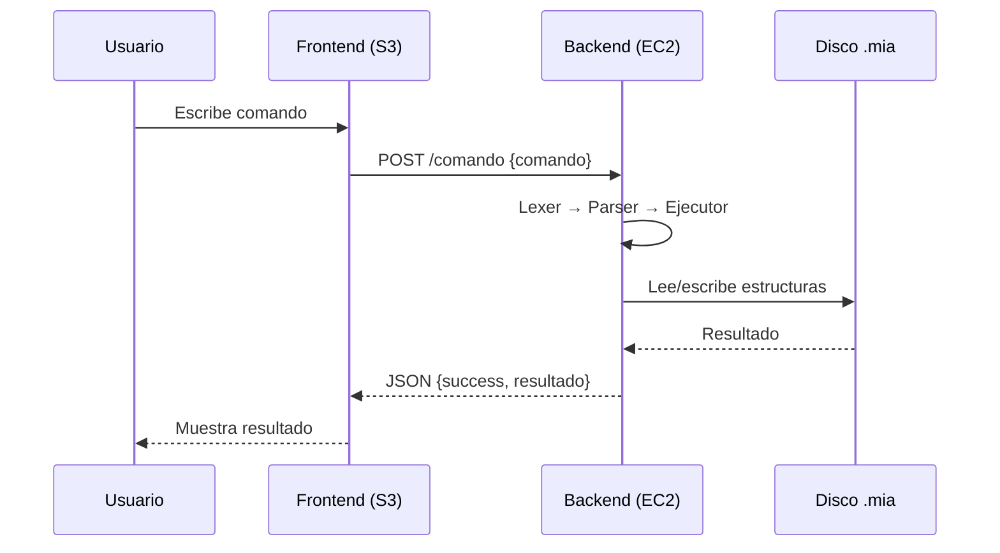

### 2.3 Módulos del Backend

| Módulo | Descripción |
|--------|-------------|
| Lexer | Convierte texto en tokens |
| Parser | Valida parámetros del comando |
| Ejecutores | Coordina la ejecución |
| Commands | Lógica de cada comando |
| Disk | Gestión de MBR y particiones |
| EXT2/EXT3 | Gestión de SuperBlock, Inodos, Bloques, Journal |
| API Handler | Endpoints REST para el frontend |
| Server | Servidor HTTP |

### 2.4 Estructura de Carpetas

```
backend/
├── include/
│   ├── commands/       # Headers de comandos
│   ├── disk/           # MBR, Partition, EBR, Mounted, Session
│   ├── ext2/           # SuperBlock, Inode, Block, Journal
│   └── nlohmann/       # JSON
├── src/
│   ├── commands/       # Implementación de comandos
│   ├── disk/           # Implementación de disk
│   └── ext2/           # Implementación de EXT2/EXT3
├── sistema/
│   ├── Ejecutores.h    # Coordinador
│   ├── Ejecutores.cpp
│   ├── api_handler.h   # API REST
│   └── api_handler.cpp
├── lexer/
├── parser/
├── main.cpp            # Servidor HTTP
└── CMakeLists.txt
```

---

## 3. Despliegue en AWS

### 3.1 Arquitectura AWS

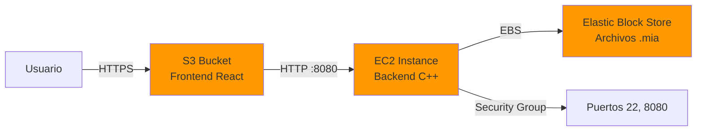

### 3.2 Configuración EC2

| Parámetro | Valor |
|-----------|-------|
| AMI | Ubuntu Server 24.04 LTS |
| Instance type | t3.micro (Free Tier) |
| Storage | 8 GB |
| Security Group | SSH (22), Custom TCP (8080) |
| Key Pair | extreamfs-key.pem |
| IP Pública | 77.113.81.18 |

### 3.3 Comandos de Despliegue

```bash
# 1. Conectar a EC2
ssh -i extreamfs-key.pem ubuntu@77.113.81.18

# 2. Instalar dependencias
sudo apt update
sudo apt install -y build-essential cmake git graphviz screen

# 3. Clonar el proyecto
git clone https://github.com/lilimoncitotale/MIA_2S2026_P2_202110378.git
cd MIA_2S2026_P2_202110378/backend

# 4. Compilar
mkdir -p build && cd build
cmake ..
make -j1

# 5. Ejecutar con screen
screen -S backend
./extreamfs
# Ctrl+A, D
```

### 3.4 Configuración S3

| Parámetro | Valor |
|-----------|-------|
| Bucket | extreamfs-frontend-202110378 |
| Región | us-east-2 |
| Static Website | Enabled |
| Index Document | index.html |
| Error Document | index.html |
| Bucket Policy | PublicReadGetObject |

### 3.5 Comandos de Despliegue Frontend

```bash
# 1. Compilar el frontend
cd frontend
npm install
npm run build

# 2. Subir a S3
aws s3 sync dist/ s3://extreamfs-frontend-202110378/ --delete

# 3. URL del sitio web
# http://extreamfs-frontend-202110378.s3-website.us-east-2.amazonaws.com
```

### 3.6 Conexión S3 ↔ EC2

**CORS configurado en el backend:**

```cpp
void configurarCORS(Response& res) {
    res.set_header("Access-Control-Allow-Origin", "*");
    res.set_header("Access-Control-Allow-Methods", "GET, POST, OPTIONS");
    res.set_header("Access-Control-Allow-Headers", "Content-Type");
}
```

**Endpoints consumidos por el frontend:**

| Endpoint | Método | Descripción |
|----------|--------|-------------|
| `/api/discos` | GET | Lista discos |
| `/api/disco?path=X` | GET | Info de un disco |
| `/api/particion?id=X` | GET | Info de una partición |
| `/api/fs/ls?id=X&path=Y` | GET | Lista carpeta |
| `/api/fs/file?id=X&path=Y` | GET | Contenido de archivo |
| `/api/login` | POST | Login gráfico |
| `/api/logout` | POST | Logout gráfico |
| `/api/session` | GET | Estado de sesión |
| `/api/journaling?id=X` | GET | Journal de una partición |

---

## 4. Estructuras de Datos EXT3

### 4.1 Estructura de una Partición EXT3

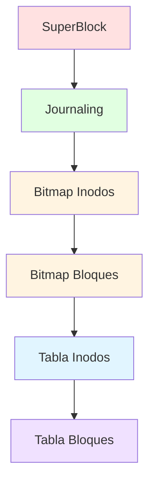

### 4.2 SuperBlock

| Campo | Tipo | Descripción |
|-------|------|-------------|
| s_filesystem_type | int | 2 = EXT2, 3 = EXT3 |
| s_inodes_count | int | Total de inodos |
| s_blocks_count | int | Total de bloques |
| s_free_inodes_count | int | Inodos libres |
| s_free_blocks_count | int | Bloques libres |
| s_mtime | time_t | Último montaje |
| s_umtime | time_t | Último desmontaje |
| s_mnt_count | int | Veces montado |
| s_magic | int | 0xEF53 |
| s_inode_size | int | Tamaño del inodo |
| s_block_size | int | Tamaño del bloque (64) |
| s_first_ino | int | Primer inodo libre |
| s_first_blo | int | Primer bloque libre |
| s_bm_inode_start | int | Inicio bitmap inodos |
| s_bm_block_start | int | Inicio bitmap bloques |
| s_inode_start | int | Inicio tabla inodos |
| s_block_start | int | Inicio tabla bloques |

### 4.3 Inodo

| Campo | Tipo | Descripción |
|-------|------|-------------|
| i_uid | int | UID del propietario |
| i_gid | int | GID del grupo |
| i_size | int | Tamaño en bytes |
| i_atime | time_t | Último acceso |
| i_ctime | time_t | Fecha de creación |
| i_mtime | time_t | Última modificación |
| i_block[15] | int[15] | 12 directos + 3 indirectos |
| i_type | char | 0 = carpeta, 1 = archivo |
| i_perm[3] | char[3] | Permisos UGO |

### 4.4 Bloque

```mermaid
graph LR
    A[Bloque] --> B[Bloque Carpeta]
    A --> C[Bloque Archivo]
    A --> D[Bloque Apuntadores]
    
    B --> E[b_content[4]<br/>4 entradas]
    C --> F[b_content[64]<br/>64 chars]
    D --> G[b_pointer[16]<br/>16 apuntadores]
```

**Bloque de Carpeta:**

| Campo | Tipo | Descripción |
|-------|------|-------------|
| b_content[4] | Content[4] | 4 entradas |

**Content:**

| Campo | Tipo | Descripción |
|-------|------|-------------|
| b_name[12] | char[12] | Nombre |
| b_inode | int | Apuntador al inodo |

### 4.5 Cálculo de Inodos y Bloques

$$
\text{tamaño\_particion} = \text{sizeof(SuperBlock)} + n \cdot \text{sizeof(Journal)} + n + 3n + n \cdot \text{sizeof(Inode)} + 3n \cdot \text{sizeof(Block)}
$$

Donde:
- $n$ = número de inodos
- $3n$ = número de bloques
- $\text{sizeof(Journal)} = 114$ bytes
- $\text{sizeof(SuperBlock)} \approx 100$ bytes
- $\text{sizeof(Inode)} \approx 100$ bytes
- $\text{sizeof(Block)} = 64$ bytes

### 4.6 Journal

| Campo | Tipo | Descripción |
|-------|------|-------------|
| j_count | int | Contador del journal |
| j_content | Information | Información de la operación |

**Information:**

| Campo | Tipo | Descripción |
|-------|------|-------------|
| i_operation[10] | char[10] | Operación realizada |
| i_path[32] | char[32] | Ruta de la operación |
| i_content[64] | char[64] | Contenido (si es archivo) |
| i_date | float | Fecha de la operación |

---

## 5. Comandos Implementados

### 5.1 Comandos Previos

| Comando | Descripción |
|---------|-------------|
| MKDISK | Crea un disco virtual `.mia` |
| RMDISK | Elimina un disco virtual |
| FDISK | Gestiona particiones |
| MOUNT | Monta una partición en RAM |
| MOUNTED | Lista particiones montadas |
| MKFS | Formatea una partición como EXT2/EXT3 |
| LOGIN | Inicia sesión |
| LOGOUT | Cierra sesión |
| MKGRP | Crea un grupo |
| RMGRP | Elimina un grupo |
| MKUSR | Crea un usuario |
| RMUSR | Elimina un usuario |
| CHGRP | Cambia grupo de usuario |
| MKDIR | Crea carpeta |
| MKFILE | Crea archivo |
| CAT | Lee archivos |
| REP | Genera reportes |

### 5.2 Comandos Nuevos

| Comando | Descripción |
|---------|-------------|
| FDISK -add | Agrega espacio a partición |
| FDISK -delete | Elimina partición |
| UNMOUNT | Desmonta partición |
| MKFS -fs | Elige EXT2 o EXT3 |
| REMOVE | Elimina archivo/carpeta |
| RENAME | Renombra archivo/carpeta |
| COPY | Copia archivo/carpeta |
| MOVE | Mueve archivo/carpeta |
| FIND | Busca archivos (con ? y *) |
| CHOWN | Cambia propietario |
| LOSS | Simula pérdida del sistema |
| JOURNALING | Muestra journal de partición |

---

## 6. Sistema de Journaling

### 6.1 Flujo del Journaling

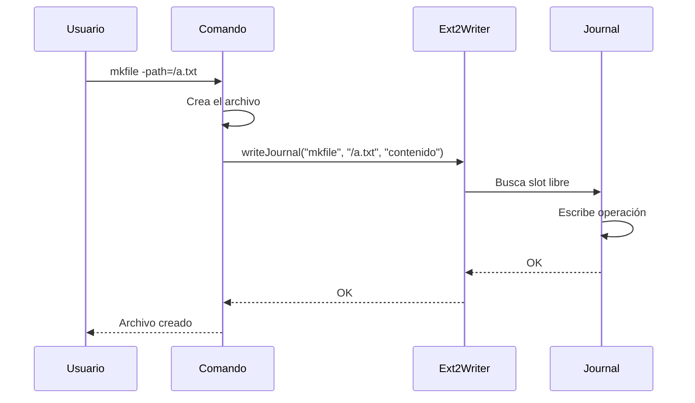

### 6.2 Estructura del Journal

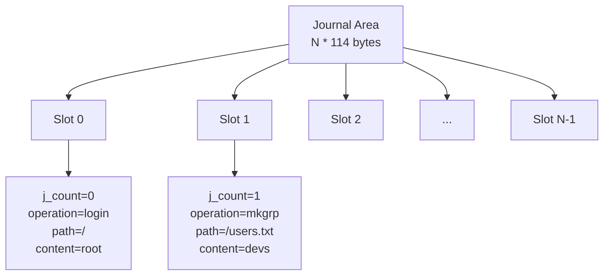

### 6.3 Comando LOSS

El comando `LOSS` simula una pérdida del sistema de archivos:

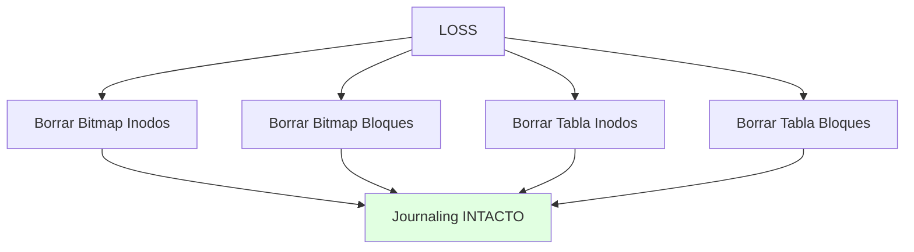

**Lo que NO se borra:**
- SuperBlock
- Journaling
- MBR

---

## 7. Comandos Nuevos

### 7.1 REMOVE

Elimina un archivo o carpeta. Verifica permisos de escritura.

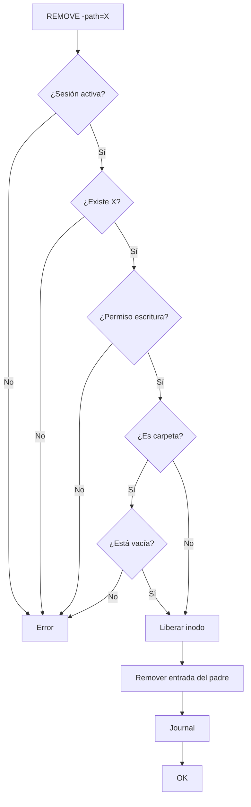

### 7.2 COPY y MOVE

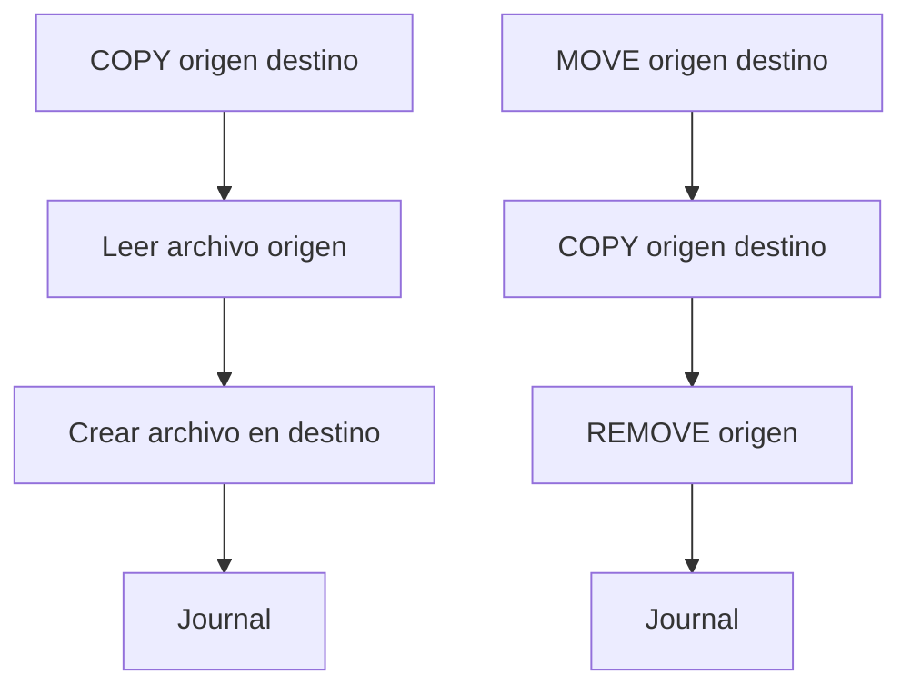

### 7.3 FIND

Busca archivos con soporte de `?` y `*`.

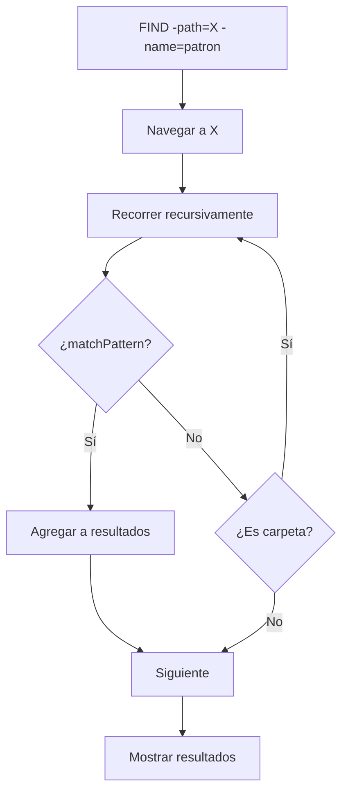

### 7.4 CHOWN

Cambia el propietario de archivo/carpeta.

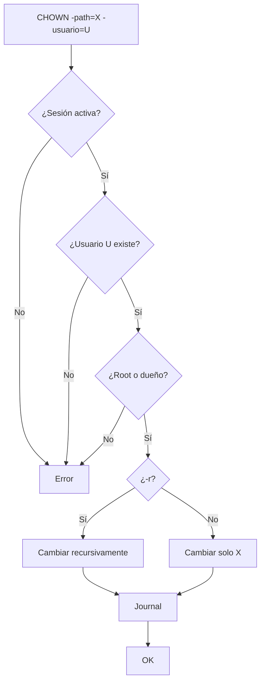

---

## 8. Interfaz Gráfica

### 8.1 Arquitectura del Frontend

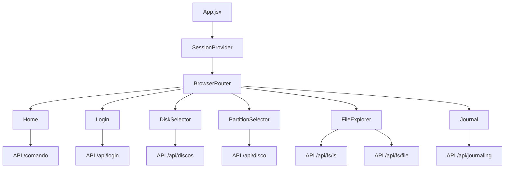

### 8.2 Flujo de Navegación

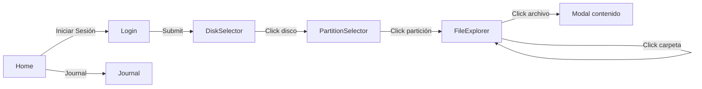

### 8.3 Pantallas

| Pantalla | Descripción |
|----------|-------------|
| Home | Área de comandos + salida |
| Login | Formulario ID/Usuario/Contraseña |
| DiskSelector | Grid de discos `.mia` |
| PartitionSelector | Grid de particiones del disco |
| FileExplorer | Explorador de archivos |
| Journal | Tabla de operaciones |

### 8.4 Componentes React

| Componente | Descripción |
|------------|-------------|
| NavBar | Barra de navegación con login/logout |
| SessionContext | Contexto de sesión |
| Home | Área de comandos |
| Login | Formulario de login |
| DiskSelector | Selector de discos |
| PartitionSelector | Selector de particiones |
| FileExplorer | Explorador de archivos |
| Journal | Visor de journal |

---

## 9. Conclusiones

- Se implementó un sistema de archivos **EXT3** completo en C++
- Se agregó **journaling** para registrar todas las operaciones
- Se desplegó el backend en **EC2** y el frontend en **S3**
- Se construyó una **interfaz gráfica** funcional con React
- Se implementaron **12 comandos nuevos** con validación de permisos
- El sistema soporta **navegación de archivos** con rutas anidadas

---

**Fin del Manual Técnico**